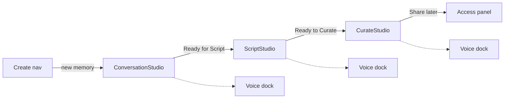

# Five-agent architecture

LifeBook is a **personal trusted-friend studio**. Creating memories is the primary job.
Sharing is optional, password-protected, and fully reversible.

## Stage studios + co-pilot dock

Craft happens in three **stage studios**. Each keeps the artifact on screen and mounts an
in-studio **VoiceDock** co-pilot (not a jump to a blank Create mic room).

| Studio | Route | Agent in dock | Artifact |
|--------|-------|---------------|----------|
| **Conversation** | `/library/conversations/[id]` | Conversation | Exact transcript |
| **Script** | `/library/stories/[id]?stage=script` | Storyteller | Title + script body |
| **Curate** | `/library/stories/[id]?stage=curate` | Curator | Listen + agent-led finishing status |

**Create** (`/talk`) is a thin door: start a new memory or continue an unfinished conversation,
then land in Conversation Studio. **Share** is access control after Curate — not a craft stage.

Shared UI: `StageShell` (navigational stage rail + coach line + dock slot), `VoiceDock`,
`useRealtimeSession`. Rail unlocks Script/Curate only after a script exists.



## Journey (one clear job per stage)

| Stage | User action | Agent |
|-------|-------------|-------|
| **Conversation** | Dialogue; resume appends to the same exact transcript | Conversation |
| **Script** | One professional script per conversation — derive, edit, hear, refine wording | Storyteller |
| **Curate** | Music + tone (Curator picks; user steers by talk), personal voice, **one optional photo** | Curator |
| **Share later** | Password access for Scripts only; recipients hear + see photo | Content Manager |

**Rules:** Conversations are vault-only (not shareable). At most one non-deleted Script per `source_conversation_id`. Agents 1–3 never create share links.

```
Continue talk ──► append transcript
Make/refresh Script ──► derive or Storyteller upsert (1:1)
Curate ──► effects + photo (not rewrite)
Share ──► access control
```

## Agents

| # | Agent | Responsibility | Default OpenAI model |
|---|-------|----------------|----------------------|
| 1 | Conversation | Empathy, exact transcript, resume dialogue (Realtime dock) | `gpt-realtime-2.1` |
| 2 | Storyteller | Derive/craft/refine Script; titles | `gpt-5.6` (text) |
| 3 | Curator | Auto-curate music/tone; voice enrollment coaching; private listen; `set_curate_choice` | Realtime for guide; BGM text `gpt-5.6-terra`; TTS clone via ElevenLabs or `gpt-4o-mini-tts` |
| 4 | Content Manager | Library; Script share passwords / revoke | Labels: `gpt-5.6-luna` |
| 5 | Chief-of-Staff | Mode handoffs + preference memory | Prefs: `gpt-5.6-terra` |

Env overrides: `OPENAI_REALTIME_MODEL`, `OPENAI_STORYTELLER_MODEL`, `OPENAI_CURATOR_MODEL`, `OPENAI_CURATOR_TTS_MODEL`, `OPENAI_CONTENT_MANAGER_MODEL`, `OPENAI_CHIEF_OF_STAFF_MODEL`, plus optional `OPENAI_TEXT_MODEL` fallback. See `services/api/app/core/openai_models.py`.

## Runtime model

One OpenAI Realtime WebRTC session for voice. Chief-of-Staff selects an instruction
pack (`conversing` | `storytelling` | `curating`) at mint time and mid-session via
`session.update` after tools `ready_for_story` / `return_to_conversation`.

Mint/pack instructions inject **before / this / after** studio context:

- Conversation: recent turns + next is Script
- Storyteller: transcript excerpt + current script text + next is Curate
- Curator: script excerpt + bgm/tone/photo + voice enrollment flags; Share is optional access later
- Curate studio: `POST /library/stories/{id}/curate/suggest` persists music/tone; optional unique ElevenLabs bed (`story_bgm_cache` / `bgm_asset_id`) when `ELEVENLABS_API_KEY` + Azure are set; otherwise library `/bgm/{mood}.mp3` + per-story TTS tone prompting
- Listen/share narration uses enrolled `UserVoice.elevenlabs_voice_id` when `clone_status=ready`; otherwise default TTS with honest `X-Narration-Voice` / `X-Narration-Note` headers (no silent pretend)

Key files:

- Packs: `services/api/app/services/agent_packs.py`
- Mint / pack API: `services/api/app/routers/realtime.py`
- Session hook + dock: `apps/web/src/lib/useRealtimeSession.ts`, `VoiceDock.tsx`, `StageShell.tsx`
- Thin Create entry: `apps/web/src/app/talk/page.tsx`; `POST /sessions/complete` with `conversation_id` appends
- Studios: `library/conversations/[id]`, `library/stories/[id]?stage=`
- Derive Script: `POST /library/conversations/{id}/derive-script` (`story_script.py`)
- Preferences: learns after session complete / script confirm
- Shares: `services/api/app/routers/shares.py` (Scripts only; optional story photo on unlock)
- Private listen: `GET /library/stories/{id}/preview` + `/narration`

## Privacy model

- Content is owner-scoped until a share row exists on a **Script**.
- Every share requires a user-chosen password (stored as hash in `shares.code_hash`).
- Recipients see a minimal shell until unlock (narration, BGM, optional one photo); comments require unlock.
- Owners can copy link, change password (same URL), or remove access.
